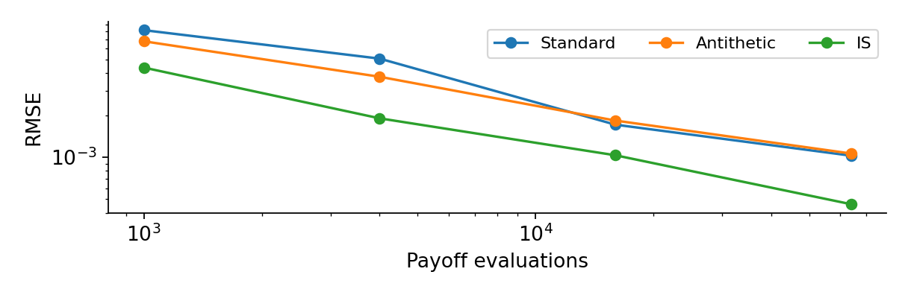
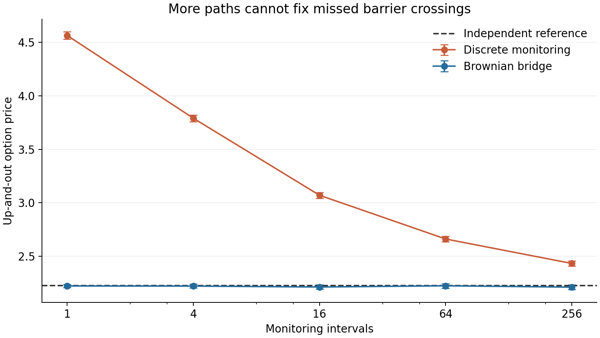
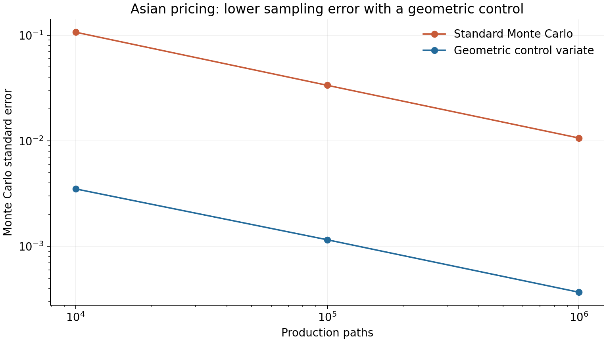

# Option pricing with Monte Carlo and finite differences

**How do we separate sampling noise, monitoring bias and grid error when pricing exotic options?**

An individual computational finance project comparing simulation and PDE methods for a digital
call, a continuously monitored up-and-out call and an arithmetic Asian call. The repository
includes the pricing engine, a local desktop comparison app, numerical checks, saved experiment
tables and the report.

[中文简介](README.zh-CN.md) · [Report](docs/report.pdf) · [Report source](docs/report.tex) ·
[Pricing engine](reproduce.py) · [Desktop app](app.py) · [Saved results](data/)



## Model and contracts

Prices use a risk-neutral geometric Brownian motion model with **S0 = 100, r = 5%, sigma = 25%,
T = 1 year**. All experiment data are generated by the model with recorded random seeds.
**This project uses no historical market dataset, Bloomberg subscription or API key.**

| Contract | Numerical difficulty | Methods |
|---|---|---|
| Cash-or-nothing digital, K = 140 | Discontinuous payoff and relatively rare exercise | Standard MC, antithetic sampling, importance sampling; explicit/implicit Euler, CN and Rannacher CN |
| Up-and-out call, K = 100, H = 130 | Barrier crossings between simulation dates | Discrete monitoring, Brownian-bridge conditioning; absorbing-boundary FD |
| Arithmetic Asian, K = 100, 12 monthly observations | Path-dependent average | Exact-date MC and a geometric Asian control variate with an independent pilot |

The Asian average excludes S0. The geometric contract provides a known control mean, not an
exact reference price for the arithmetic Asian contract.

## What I implemented

- Exact-date lognormal simulation, discounting, MC standard errors and confidence intervals.
- Equal-payoff-budget comparisons of variance reduction, with correct antithetic pair counts.
- Theta-scheme finite differences and tridiagonal solves, payoff averaging, explicit stability
  checks and Rannacher startup to handle discontinuities and oscillations.
- Brownian-bridge survival weighting to remove missed-crossing bias under the specified model,
  checked against an independent reflection-principle quadrature.
- A geometric Asian control variate fitted on **20,000 independent pilot paths**, with pilot
  runtime included, plus independent Cholesky-based validation and repeated experiments.
- A Tkinter app to compare prices, standard errors, intervals, errors where a benchmark exists,
  execution time and CSV exports.

## Selected results

| Experiment | Recorded result | Interpretation |
|---|---|---|
| Digital analytical price | 0.09691513445 | Exact benchmark for MC and FD |
| Digital importance sampling, 1M payoff evaluations | SE 0.000125 vs 0.000288 for standard MC | About 5.28x equal-budget variance reduction |
| Averaged Rannacher CN, digital M = N = 1600 | Absolute error about 1.46e-7 | Approximately second-order refinement in this experiment |
| Barrier discrete MC, 256 intervals | Price 2.431888 vs reference 2.223539 | Increasing paths alone does not remove monitoring bias |
| Asian geometric control, 1M production paths | 7.312727; SE 0.000368; 95% interval [7.312006, 7.313448] | About 835x variance reduction at equal production counts |
| Independent Asian validation, 2M paths | 7.312286; SE 0.000260 | Agreement within one combined standard error |

Including the pilot's measured runtime, the recorded Asian variance-runtime improvement is
about **675x** at one million production paths. This is an experiment-specific efficiency
ratio, not a general speed guarantee. Historical timings are machine-dependent.





## Research workflow

1. Establish analytical or independently integrated benchmarks for the two core contracts.
2. Compare MC methods using repeated runs, standard errors and equal sampling budgets.
3. Refine FD grids and inspect stability, boundary truncation and startup oscillations.
4. Separate barrier monitoring bias from sampling error using paired paths and bridge weights.
5. Measure the Asian control's precision gain after pilot cost, then cross-check with an
   independently constructed joint-normal simulation and 80 repeated pilot/production runs.

## Quick start

Python **3.13** matches the original experiment environment. The core code uses NumPy,
SciPy and Matplotlib. Tkinter is included in typical Windows Python installers; Linux may
require the system package `python3-tk` for the desktop app.

```bash
python -m venv .venv
# Windows: .venv\Scripts\activate
# macOS/Linux: source .venv/bin/activate
python -m pip install -r requirements.txt
python verify.py
```

Launch the local app:

```bash
python app.py
```

Reproduce experiments (may take several minutes):

```bash
python reproduce.py
python reproduce.py --extension-only
python audit_asian.py
python build_report_assets.py
python scripts/plot_summary.py
```

`reproduce.py` regenerates saved CSVs and figures; `--extension-only` runs just the Asian
extension. `audit_asian.py` independently checks saved Asian production and replication rows
and writes its audit JSON. `build_report_assets.py` refreshes figures, LaTeX tables and
generated table blocks inside `docs/report.tex`. These commands overwrite generated results,
so keep edits in version control. MC estimates and runtimes need not exactly match across
library versions or machines.

## Repository guide

```text
reproduce.py             Pricing methods and experiment runner
app.py                   Local interactive comparison app
verify.py                Mathematical, convergence and application checks
audit_asian.py           Detailed saved-result audit and independent validation
build_report_assets.py   Rebuild report figures and generated tables
data/                    Model-generated results, seeds and environment metadata
figures/                 Result plots
tables/                  Generated LaTeX tables
docs/                    Report PDF and editable source
```

## Scope, attribution and limitations

Individual FMAT3888 discipline assessment, University of Sydney (2026), presented as a public
research portfolio. The published version removes the student identifier and old drafts while
preserving the methods and recorded experiment outputs. It includes **Extension B (Asian
options)**, matching the final report, rather than mixing different assessment extensions.

The model assumes constant coefficients, no transaction costs and a known risk-neutral GBM.
Confidence intervals quantify MC sampling error, not model misspecification or uncorrected
monitoring bias. Asian validation is statistical, not an exact arithmetic-Asian benchmark.
The Asian high-dimensional FD formulation is discussed in the report but is not implemented.

References: Giles and Carter (2006), Shevchenko and Del Moral (2015), and Boyle, Broadie and
Glasserman (2001). Full citations and method explanations appear in the report.
